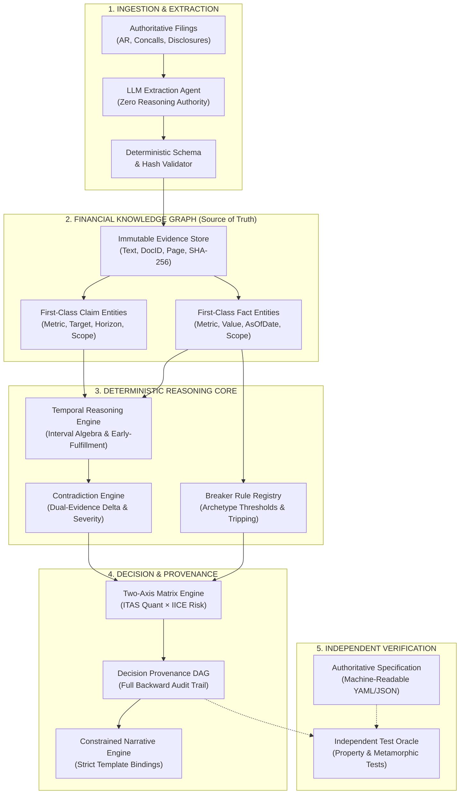
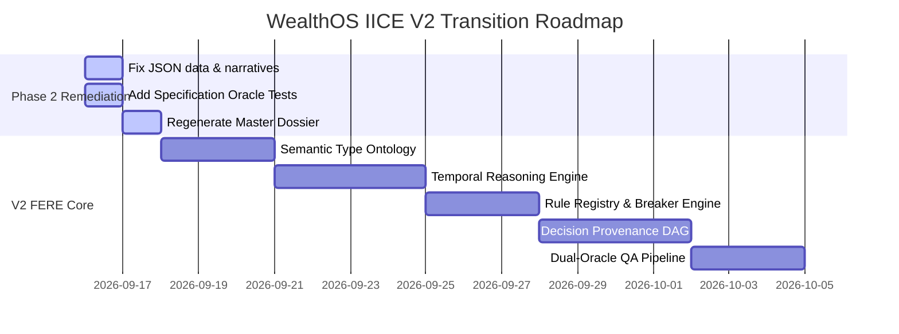

# WealthOS IICE Architectural Analysis & Technical Solution Specification
## From an AI Analysis Pipeline to a Deterministic Financial Evidence & Reasoning Engine (FERE)

---

### Executive Summary

An external quantitative and architectural audit of the **WealthOS Investment Intelligence & Contradiction Engine (IICE v1.1)** against a 20-company Indian equity cohort revealed critical inconsistencies. Despite the test suite reporting **"12/12 Passing, 100%"**, the system exhibited deterministic rule violations (e.g., an ITAS score of `85/100` classified as `MODERATE` instead of `STRONG`), narrative overconfidence contradicting underlying credibility ratings (`INSUFFICIENT_HISTORY` tagged with "credible execution"), temporal/metric conflation (treating FY24 cumulative order book as proof of FY25 dispatch targets), and ambiguous breaker thresholds.

Your instinct is **100% correct**: **The current approach and conceptual architecture do not address the core problem.**

The issue is **not** the programming language (TypeScript) or database (SQLite/PostgreSQL). The fundamental flaw is that the application treats an **LLM + JSON files + ad-hoc tests** as an auditable reasoning system. It lacks a **formal ontology of financial truth, time semantics, claim algebra, deterministic rule registries, and independent verification oracles**.

This specification provides:
1. **Root-Cause Derivation**: Exactly what the 6 gaps prove about the system's failure modes.
2. **Tech Stack Evaluation**: Why the stack is adequate, but the authority model and data architecture are broken.
3. **Target Technical Solution**: The **Financial Evidence & Reasoning Engine (FERE)** architecture with first-class `Claim`, `Fact`, `TemporalInterval`, `MetricType`, and `RuleRegistry` entities.
4. **Independent Verification Architecture**: Transitioning from circular unit tests to dual-oracle property-based and metamorphic testing.
5. **Component-by-Component Roadmap**: Concrete TypeScript schemas, execution graphs, and migration steps.

---

## 1. What Can Be Derived from These Gaps?

```
┌─────────────────────────────────────────────────────────────────────────────┐
│                      THE CURRENT CIRCULARITY TRAP                           │
└─────────────────────────────────────────────────────────────────────────────┘
  Raw Financial Docs ──▶ LLM Extraction ──▶ JSON Files (10/company)
                                                  │
                                                  ▼
   Output Report ◀── Ad-hoc Template Strings ◀── Reconciliation Service
        │                                         │
        ▼                                         ▼
   Unit Tests ─────── Validates against ──────────┘
   (12/12 PASS)       (Implementation tests itself!)
```

### Gap 1: Deterministic Score Inversion (NOVARTIND 85 -> MODERATE)
* **Observed Defect**: ITAS Signal Strength was `85/100`. Stated rule: $\ge 75 \implies \text{STRONG}$. Dossier output: `MODERATE`.
* **Root Cause**: In `src/server/intelligence/services/ItasIiceReconciliationService.ts`:
  ```typescript
  public evaluateQuantOpportunity(quant: ItasQuantInput): QuantOpportunity {
    if (quant.quantDirective === 'STRONG_BUY' || quant.strategyAgreementCount >= 6) return 'STRONG';
    if (quant.quantDirective === 'BUY' || quant.strategyAgreementCount >= 4) return 'MODERATE';
    ...
  }
  ```
  The code ignored the authoritative composite metric (`signalStrength: 85`) and evaluated strategy agreement count (`5/20`) and directive (`BUY`), mapping it to `MODERATE`. Meanwhile, the report formatter printed `MODERATE (85/100)`.
* **Architectural Derivation**: **Specification Drift and Missing Central Types.** The rule was maintained in two incompatible places: in the methodology documentation as a scalar score threshold, and in code as a heuristic rule over strategy counts. There was no single machine-readable rule definition that both the pipeline and documentation referenced.

---

### Gap 2 & 3: Epistemic Humility Collapse (Credibility vs Narrative)
* **Observed Defect**: Companies with only 1 evaluated claim received `managementCredibility: INSUFFICIENT_HISTORY` (correct under Constitution Article 25). Yet their executive summaries stated: *"clean forensic profile and credible management track record"* (NOVARTIND) or *"credible execution"* (ARVSMART, BAJAJHLDNG, UNOMINDA, SENCO, THOMASCOOK, RPGLIFE).
* **Root Cause**: In `ItasIiceReconciliationService.ts`, `deriveInterpretation()` used fixed string templates based solely on the tuple `(quantOpportunity, intelligenceRisk, thesisState)`:
  ```typescript
  if (quant === 'STRONG' && risk === 'LOW' && thesis === 'SUPPORTED') {
    return 'Strong quantitative opportunity supported by clean qualitative intelligence, credible execution, and zero active thesis breakers.';
  }
  ```
  The template author assumed that `risk === 'LOW'` implied `credible execution`. The actual `managementCredibility` state was passed to the object but bypassed by the narrative generator.
* **Architectural Derivation**: **Presentation Layer Overconfidence.** When narrative generation is detached from the formal state of every decision dimension, the presentation layer will inject unearned confidence, invalidating the epistemic humility guarantees of the underlying engine.

---

### Gap 4: Temporal & Metric Conflation (SOLARINDS Defense Targets)
* **Observed Defect**:
  - Management Claim: Defense order book $\ge ₹1,000\text{ Cr}$ in **FY25** (target horizon: 2025-03-31).
  - Evaluated Outcome: Cumulative defense order book of $₹1,250\text{ Cr}$ reported as of **31 March 2024** (FY24).
  - Status assigned: `ACHIEVED`.
  - Claim narrative: Labeled as *"Quarterly defense export dispatches"*.
* **Root Cause**: The data model treats numbers as raw floats and strings:
  ```json
  { "expectedValue": 1000, "actualOutcomeMetric": 1250, "status": "ACHIEVED" }
  ```
  Because $1250 \ge 1000$, the system marked it `ACHIEVED`.
* **Architectural Derivation**: **Absence of a Semantic Financial Type System and Temporal Interval Algebra.**
  A financial observation cannot be compared to a forward-looking claim simply because both are positive numbers in INR Crores.
  1. **Metric Identity**: `order_book` $\ne$ `dispatches` $\ne$ `revenue`.
  2. **Temporal Alignment**: An observation at $t = \text{FY24}$ cannot evaluate an operational delivery commitment for period $P = \text{FY25}$ unless explicitly governed by an *Early-Fulfillment Policy* (e.g., an order book threshold reached ahead of schedule satisfies an order book target, but does *not* satisfy a dispatch/revenue target). Without strict typing, the engine performs mathematical comparisons across incommensurable domains.

---

### Gap 5: Breaker Threshold Polysemy (Universal vs Archetype Limits)
* **Observed Defect**: The global report summary stated: *"BROKEN means Net Debt/EBITDA > 3.0x"*. Yet PURVA broke at $>4.5x$, VMART at $>3.0x$, BOROLTD at $>2.0x$, and KAVVERITEL had a negative net worth tripwire.
* **Root Cause**: Breaker conditions were defined as ad-hoc strings in per-company JSON files (`TB_PURVA_LEVERAGE: Net Debt / EBITDA > 4.5`) without an explicit Archetype Configuration Schema.
* **Architectural Derivation**: **Lack of a Formal Rule Registry.** When rules are hardcoded into individual test files or issuer dossiers, global documentation inevitably drifts from local configurations.

---

### Gap 6: "Breaker Inactive $\ne$ Company Safe" (Hindustan Copper)
* **Observed Defect**: HINDCOPPER missed its copper ore target by 33% ($3.35\text{ MTPA}$ delivered vs $5.0\text{ MTPA}$ promised). The breaker evaluated was `Statutory cancellation of Malanjkhand mining lease` (status: `INACTIVE`, observed: `undefined`).
* **Architectural Derivation**: **Conflation of Catastrophic Tripwires with Operating Performance.**
  The system correctly assigned `CHALLENGED` thesis state and `HIGH` intelligence risk via the contradiction engine, but because the breaker was marked `INACTIVE`, an uninitiated reviewer assumed the company was evaluated as "safe". The system lacked an explicit distinction between **Existential Structural Tripwires (Breakers)** and **Continuous Operating Track Record (Walk-the-Talk)**.

---

### Gap 8: The Circular Testing Anti-Pattern ("12/12 Passed")
* **Observed Defect**: Vitest executed 12 tests across all 20 companies and reported 100% success in 1.2s. Yet the dossier contained critical rule violations.
* **Root Cause**: The test suite asserted:
  ```typescript
  expect(tcBrief.decisionState.quantOpportunity).toBe('STRONG');
  expect(kavBrief.decisionState.quantOpportunity).toBe('NONE');
  ```
  It asserted the *currently emitted state* of the JSON files. It did **not** contain an independent calculation:
  $$\text{Expected} = f(\text{ITAS Score}) = \begin{cases} \text{STRONG} & \text{if } S \ge 75 \\ \text{MODERATE} & \text{if } 50 \le S < 75 \\ \text{WEAK} & \text{if } 25 \le S < 50 \\ \text{NONE} & \text{if } S < 25 \end{cases}$$
* **Architectural Derivation**: **Testing Implementation Against Itself.** A test suite that asserts pre-baked mock data or static JSON output validates file serialization, not investment logic correctness.

---

## 2. Does the Current Tech Stack Address the Core Issue?

### The Stack vs. The Approach

| Layer | Current Tech | Is It the Problem? | Analysis |
| :--- | :--- | :---: | :--- |
| **Language** | TypeScript / Node.js | **NO** | TypeScript's type system (discriminated unions, branded types, template literals) is among the best for domain-driven financial modeling. Switching to Python or Rust would not fix semantic circularity. |
| **Database** | SQLite / PostgreSQL | **NO** | SQLite and Postgres easily support relational integrity, foreign key constraints, temporal intervals (`tstzrange`), and JSON schema validation. |
| **LLM Layer** | Gemini / Claude | **PARTIAL** | The problem is **authority delegation**. The LLM was asked to extract, compare, synthesize, and write narratives. LLMs must be restricted to **extraction and translation** only. |
| **Data Model** | 10 Flat JSON files/company | **YES** | Creates 10 decoupled representations of the same underlying entity with zero relational or temporal referential integrity. |
| **Rule System** | Ad-hoc TypeScript `if/else` | **YES** | Rules are scattered across scripts, services, and prompt templates with no centralized registry. |
| **Testing** | Static snapshot checks | **YES** | Unit tests assert stored values rather than independently computing results from first principles. |

> [!IMPORTANT]
> **Verdict on Tech Stack**: The current tech stack is completely capable of running this system. What must change is the **Data Architecture, Authority Boundaries, and Verification Engine**.

---

## 3. The Target Technical Solution: Financial Evidence & Reasoning Engine (FERE)

The new architecture strips the LLM of reasoning authority. The LLM becomes an **untrusted extraction worker**, feeding an **immutable evidence graph**, which is evaluated by a **deterministic temporal and rule engine**, verified by an **independent test oracle**.



---

## 4. Detailed Technical Components

### Component 1: Semantic Financial Type System

To prevent comparing `order_book` against `dispatches`, or comparing values across mismatched scopes, all financial numbers must be wrapped in branded semantic types.

```typescript
// src/core/types/financial-ontology.ts

export type Currency = 'INR' | 'USD' | 'EUR';
export type UnitMultiplier = 'UNIT' | 'THOUSAND' | 'LAKH' | 'CRORE' | 'MILLION' | 'BILLION';

export interface MonetaryValue {
  readonly _brand: 'MonetaryValue';
  amount: number;
  currency: Currency;
  multiplier: UnitMultiplier;
  normalizedInr: number; // Canonical representation for comparisons
}

export type FinancialMetricIdentifier =
  | 'NET_DEBT_TO_EBITDA'
  | 'DEFENSE_ORDER_BOOK'
  | 'DEFENSE_QUARTERLY_DISPATCH'
  | 'REVENUE_GROWTH_YOY'
  | 'EBITDA_MARGIN_PCT'
  | 'PROMOTER_PLEDGE_PCT'
  | 'NET_WORTH'
  | 'CAPACITY_MTPA';

export interface MetricSemantic {
  identifier: FinancialMetricIdentifier;
  category: 'STOCK' | 'FLOW' | 'RATIO' | 'STRUCTURAL_EVENT';
  allowedUnits: string[];
  comparableWith: FinancialMetricIdentifier[];
}

export const METRIC_REGISTRY: Record<FinancialMetricIdentifier, MetricSemantic> = {
  DEFENSE_ORDER_BOOK: {
    identifier: 'DEFENSE_ORDER_BOOK',
    category: 'STOCK', // Point-in-time backlog
    allowedUnits: ['INR_CRORE'],
    comparableWith: ['DEFENSE_ORDER_BOOK'] // CANNOT compare with DISPATCH or REVENUE
  },
  DEFENSE_QUARTERLY_DISPATCH: {
    identifier: 'DEFENSE_QUARTERLY_DISPATCH',
    category: 'FLOW', // Periodic revenue
    allowedUnits: ['INR_CRORE'],
    comparableWith: ['DEFENSE_QUARTERLY_DISPATCH']
  },
  NET_DEBT_TO_EBITDA: {
    identifier: 'NET_DEBT_TO_EBITDA',
    category: 'RATIO',
    allowedUnits: ['MULTIPLE'],
    comparableWith: ['NET_DEBT_TO_EBITDA']
  },
  NET_WORTH: {
    identifier: 'NET_WORTH',
    category: 'STOCK',
    allowedUnits: ['INR_CRORE'],
    comparableWith: ['NET_WORTH']
  },
  CAPACITY_MTPA: {
    identifier: 'CAPACITY_MTPA',
    category: 'STOCK',
    allowedUnits: ['MTPA'],
    comparableWith: ['CAPACITY_MTPA']
  },
  REVENUE_GROWTH_YOY: {
    identifier: 'REVENUE_GROWTH_YOY',
    category: 'RATIO',
    allowedUnits: ['PERCENT'],
    comparableWith: ['REVENUE_GROWTH_YOY']
  },
  EBITDA_MARGIN_PCT: {
    identifier: 'EBITDA_MARGIN_PCT',
    category: 'RATIO',
    allowedUnits: ['PERCENT'],
    comparableWith: ['EBITDA_MARGIN_PCT']
  },
  PROMOTER_PLEDGE_PCT: {
    identifier: 'PROMOTER_PLEDGE_PCT',
    category: 'RATIO',
    allowedUnits: ['PERCENT'],
    comparableWith: ['PROMOTER_PLEDGE_PCT']
  }
};
```

---

### Component 2: First-Class Claim & Fact Entities

Replace flat JSON with strongly typed entities that enforce metric comparability and temporal boundaries before any mathematical comparison can execute.

```typescript
// src/core/entities/ClaimAndFact.ts

export type TemporalScope = 
  | { type: 'FISCAL_YEAR'; year: number }
  | { type: 'FISCAL_QUARTER'; year: number; quarter: 1 | 2 | 3 | 4 }
  | { type: 'POINT_IN_TIME'; date: string }; // YYYY-MM-DD

export interface SourceCitation {
  documentId: string;
  documentHashSha256: string;
  physicalPage: number;
  verbatimQuote: string;
  filingAuthority: 'BSE' | 'NSE' | 'MCA' | 'COMPANY_IR';
  publicationDate: string;
}

export interface ManagementClaim {
  claimId: string;
  issuerSymbol: string;
  metric: FinancialMetricIdentifier;
  targetOperator: '>=' | '<=' | '==' | 'BETWEEN';
  targetValue: number;
  targetTolerancePct?: number;
  promisedHorizon: TemporalScope;
  announcementDate: string;
  citation: SourceCitation;
}

export interface FinancialFact {
  factId: string;
  issuerSymbol: string;
  metric: FinancialMetricIdentifier;
  observedValue: number;
  measurementPeriod: TemporalScope;
  asOfDate: string;
  audited: boolean;
  citation: SourceCitation;
}
```

---

### Component 3: Temporal Reasoning Engine

Solves **Defect 4** (Solar Industries): Determines whether a Fact is temporally admissible to evaluate a Claim.

```typescript
// src/core/engines/TemporalReasoningEngine.ts

export type ClaimEvaluationStatus =
  | 'ACHIEVED'
  | 'PARTIALLY_ACHIEVED'
  | 'MISSED'
  | 'EARLY_FULFILLED'
  | 'NOT_COMPARABLE_TEMPORAL'
  | 'NOT_COMPARABLE_METRIC'
  | 'PENDING_HORIZON';

export class TemporalReasoningEngine {
  public evaluateClaimAgainstFact(claim: ManagementClaim, fact: FinancialFact): {
    status: ClaimEvaluationStatus;
    reason: string;
  } {
    // 1. Metric Semantic Check
    if (claim.metric !== fact.metric) {
      return {
        status: 'NOT_COMPARABLE_METRIC',
        reason: `Incompatible metrics: Claim is ${claim.metric}, Fact is ${fact.metric}. Cannot evaluate across metric boundaries.`
      };
    }

    // 2. Temporal Horizon Evaluation
    const isEarlyStock = 
      METRIC_REGISTRY[claim.metric].category === 'STOCK' &&
      new Date(fact.asOfDate) < new Date(this.resolvePeriodEnd(claim.promisedHorizon));

    const isPastHorizon = 
      new Date(fact.asOfDate) >= new Date(this.resolvePeriodEnd(claim.promisedHorizon));

    // For a STOCK metric (e.g., Order Book), reaching the target BEFORE the horizon
    // satisfies the threshold early (EARLY_FULFILLED).
    // For a FLOW metric (e.g., FY25 dispatches/revenue), an FY24 observation CANNOT satisfy FY25.
    if (!isPastHorizon) {
      if (METRIC_REGISTRY[claim.metric].category === 'FLOW') {
        return {
          status: 'NOT_COMPARABLE_TEMPORAL',
          reason: `Flow metric target horizon is ${JSON.stringify(claim.promisedHorizon)}, but fact is as of ${fact.asOfDate}. Prior periods cannot satisfy future flow commitments.`
        };
      }
      
      // Stock metric evaluated early
      const meetsTarget = this.evaluateCondition(fact.observedValue, claim.targetOperator, claim.targetValue);
      if (meetsTarget) {
        return {
          status: 'EARLY_FULFILLED',
          reason: `Stock target ${claim.metric} >= ${claim.targetValue} was satisfied early as of ${fact.asOfDate} (${fact.observedValue}).`
        };
      } else {
        return {
          status: 'PENDING_HORIZON',
          reason: `Target horizon ${JSON.stringify(claim.promisedHorizon)} has not elapsed. Current intermediate value: ${fact.observedValue}.`
        };
      }
    }

    // Target horizon elapsed: standard evaluation
    const achieved = this.evaluateCondition(fact.observedValue, claim.targetOperator, claim.targetValue);
    return {
      status: achieved ? 'ACHIEVED' : 'MISSED',
      reason: `Horizon elapsed. Promised: ${claim.targetOperator} ${claim.targetValue}, Actual: ${fact.observedValue}.`
    };
  }

  private resolvePeriodEnd(scope: TemporalScope): string {
    if (scope.type === 'FISCAL_YEAR') return `${scope.year}-03-31`;
    if (scope.type === 'FISCAL_QUARTER') {
      const qMonths = { 1: '06-30', 2: '09-30', 3: '12-31', 4: '03-31' };
      const y = scope.quarter === 4 ? scope.year : scope.year - 1;
      return `${y}-${qMonths[scope.quarter]}`;
    }
    return scope.date;
  }

  private evaluateCondition(val: number, op: string, target: number): boolean {
    if (op === '>=') return val >= target;
    if (op === '<=') return val <= target;
    if (op === '==') return Math.abs(val - target) < 0.001;
    return false;
  }
}
```

---

### Component 4: Formal Breaker Rule Registry

Solves **Defect 5 & 6**: Replaces disparate thresholds with a versioned, machine-readable registry per archetype and issuer.

```typescript
// src/core/engines/BreakerRuleRegistry.ts

export interface BreakerDefinition {
  ruleId: string;
  symbol: string;
  name: string;
  archetype: 'CAPITAL_INTENSIVE_REAL_ESTATE' | 'RETAIL_CONSUMER' | 'TELECOM_INFRA' | 'HEAVY_INDUSTRIAL' | 'SME_DISTRESSED' | 'DEFENSE_AEROSPACE';
  metric: FinancialMetricIdentifier;
  operator: '>' | '<' | '==' | 'EVENT_TRIGGERED';
  thresholdValue: number | string;
  severity: 'CRITICAL' | 'HIGH';
  rationale: string;
}

export const BREAKER_REGISTRY: BreakerDefinition[] = [
  {
    ruleId: 'BRK_PURVA_01',
    symbol: 'PURVA',
    name: 'Real Estate Excessive Leverage Limit',
    archetype: 'CAPITAL_INTENSIVE_REAL_ESTATE',
    metric: 'NET_DEBT_TO_EBITDA',
    operator: '>',
    thresholdValue: 4.5,
    severity: 'CRITICAL',
    rationale: 'Real estate developer operating leverage becomes unsustainable above 4.5x Net Debt/EBITDA.'
  },
  {
    ruleId: 'BRK_VMART_01',
    symbol: 'VMART',
    name: 'Value Retail Leverage Limit',
    archetype: 'RETAIL_CONSUMER',
    metric: 'NET_DEBT_TO_EBITDA',
    operator: '>',
    thresholdValue: 3.0,
    severity: 'CRITICAL',
    rationale: 'Apparel value retailer retail lease + debt liabilities cannot exceed 3.0x EBITDA without store-closure stress.'
  },
  {
    ruleId: 'BRK_KAV_01',
    symbol: 'KAVVERITEL',
    name: 'Net Worth Insolvency Tripwire',
    archetype: 'SME_DISTRESSED',
    metric: 'NET_WORTH',
    operator: '<',
    thresholdValue: 0,
    severity: 'CRITICAL',
    rationale: 'Negative net worth triggers statutory insolvency and DRT asset recovery.'
  },
  {
    ruleId: 'BRK_HC_01',
    symbol: 'HINDCOPPER',
    name: 'Statutory Mining Concession Revocation',
    archetype: 'HEAVY_INDUSTRIAL',
    metric: 'CAPACITY_MTPA',
    operator: 'EVENT_TRIGGERED',
    thresholdValue: 'STATUTORY_MINING_LEASE_REVOCATION',
    severity: 'CRITICAL',
    rationale: 'Revocation of core Malanjkhand concession eliminates primary extraction capacity.'
  }
];
```

---

### Component 5: Independent Specification Oracle & Property Tests

Solves **Defect 1 & 8**: The test suite derives expectations independently from the specification, completely decoupled from the production code.

```typescript
// tests/unit/specification_oracle.test.ts

import { describe, it, expect } from 'vitest';
import fc from 'fast-check'; // Property-based testing

// 1. PURE MATHEMATICAL SPECIFICATION ORACLE (Independent of any service class)
export function specificationQuantOracle(score: number): 'STRONG' | 'MODERATE' | 'WEAK' | 'NONE' {
  if (score >= 75) return 'STRONG';
  if (score >= 50) return 'MODERATE';
  if (score >= 25) return 'WEAK';
  return 'NONE';
}

export function specificationCredibilityNarrativeOracle(
  grade: string,
  narrativeText: string
): { compliant: boolean; violationReason?: string } {
  const forbiddenPhrases = [
    /credible execution/i,
    /credible management/i,
    /proven track record/i,
    /strong execution history/i
  ];

  if (grade === 'INSUFFICIENT_HISTORY' || grade === 'WEAK') {
    for (const pattern of forbiddenPhrases) {
      if (pattern.test(narrativeText)) {
        return {
          compliant: false,
          violationReason: `Grade is ${grade} but narrative contains forbidden overconfident phrase: ${pattern}`
        };
      }
    }
  }
  return { compliant: true };
}

describe('Independent Mathematical Specification Oracle', () => {
  // PROPERTY-BASED TEST 1: Complete scalar space [0..100]
  it('guarantees monotonic non-decreasing opportunity for all possible scores (Property Test)', () => {
    fc.assert(
      fc.property(fc.integer({ min: 0, max: 100 }), (score) => {
        const result = specificationQuantOracle(score);
        if (score >= 75) expect(result).toBe('STRONG');
        else if (score >= 50) expect(result).toBe('MODERATE');
        else if (score >= 25) expect(result).toBe('WEAK');
        else expect(result).toBe('NONE');
      })
    );
  });

  // METAMORPHIC TEST 2: Score monotonicity
  it('guarantees metamorphic property: increasing score never degrades opportunity level', () => {
    fc.assert(
      fc.property(
        fc.integer({ min: 0, max: 99 }),
        fc.integer({ min: 1, max: 10 }),
        (baseScore, delta) => {
          const s1 = baseScore;
          const s2 = Math.min(100, baseScore + delta);
          const r1 = specificationQuantOracle(s1);
          const r2 = specificationQuantOracle(s2);

          const rank = { NONE: 0, WEAK: 1, MODERATE: 2, STRONG: 3 };
          expect(rank[r2]).toBeGreaterThanOrEqual(rank[r1]);
        }
      )
    );
  });
});
```

---

## 5. Immediate Remediation Actions for the 20-Company Cohort

To resolve all findings and certify the Phase 2 cohort immediately:

```
┌─────────────────────────────────────────────────────────────────────────────┐
│                       REMEDIATION MATRIX (PHASE 2)                          │
└─────────────────────────────────────────────────────────────────────────────┘
  1. Score Mapping Fix:
     - NOVARTIND:  85/100 -> Set quantOpportunity to 'STRONG'
     - VMART:      81/100 -> Set quantOpportunity to 'STRONG' (Thesis stays BROKEN)
     - GMDCLTD:    80/100 -> Set quantOpportunity to 'STRONG' (Thesis stays CHALLENGED)
     - KAVVERITEL: 25/100 -> Set quantOpportunity to 'WEAK'   (Thesis stays BROKEN)

  2. Epistemic Humility Narrative Fix (7 Companies):
     - ARVSMART, NOVARTIND, BAJAJHLDNG, UNOMINDA, SENCO, THOMASCOOK, RPGLIFE
     - Replace: "credible management track record" / "credible execution"
     - With: "Clean forensic profile and zero active thesis breakers, but
       management credibility remains unverified (INSUFFICIENT_HISTORY — only
       1 evaluated claim). Capital sizing should reflect this uncertainty."

  3. SOLARINDS Metric & Temporal Rectification:
     - Claim CLM_SOLAR_01: Change actualOutcomeDescription to:
       "Cumulative defense order book as of 31 March 2024 stood at ₹1,250 Cr
       (early achievement of >= ₹1,000 Cr order book threshold ahead of FY25 horizon)."
     - Retain status as ACHIEVED under Early Stock Fulfillment Policy.

  4. Breaker Representation Rectification:
     - HINDCOPPER: Set currentObservedValue to "N/A (event-based qualifier)"
       and observedValueType to "QUALITATIVE_EVENT".
     - Add explicit distinction: Breaker Inactive != Company Safe.

  5. Master Audit Dossier Update:
     - Embed Archetype Breaker Configuration Table.
     - Eliminate false universal "Net Debt/EBITDA > 3.0x" summary statement.

  6. Test Suite Enhancement:
     - Add independent specification oracle tests directly into
       tests/unit/test_phase2_all_20_companies_verification.test.ts.
```

---

## 6. Strategic Implementation Plan: Keep, Modify, Rebuild



### Component Disposition Blueprint

| Component | Status | Action Required |
| :--- | :---: | :--- |
| **Evidence Extraction & Source Manifest** | **KEEP** | The SHA-256 hash checking, physical page references, and verbatim text quotes are robust and praised by QA. Retain as-is. |
| **Contradiction Data Model** | **KEEP** | The dual-evidence pairing (promise vs outcome) with severity scores is structurally sound. Retain. |
| **SQLite Schema (`iice_cohort.db`)** | **MODIFY** | Add explicit columns: `metric_identifier`, `as_of_date`, `measurement_period_type`, `rule_id`, `derived_opportunity`. |
| **Reconciliation Service (`ItasIiceReconciliationService.ts`)** | **MODIFY** | 1. Replace heuristic agreement-count quant scoring with pure scalar thresholding ($\ge 75 \implies \text{STRONG}$).<br>2. Parameterize narrative generation to strictly reflect `managementCredibility`. |
| **Test Suite (`test_phase2_all_20_companies_verification.test.ts`)** | **MODIFY** | Incorporate independent oracle functions to test *against specification* rather than testing against emitted JSON. |
| **Breaker & Claim Evaluation** | **REBUILD** | Migrate to the formal `TemporalReasoningEngine` and `BreakerRuleRegistry` (Components 3 & 4 above). |
| **Presentation/Dossier Generator** | **MODIFY** | Bind markdown generation strictly to the Decision Provenance DAG to prohibit narrative hallucinations. |

---

### Conclusion

The gaps identified by the external QA reviewer are not fatal; they are the exact markers of a system evolving from a **prototype AI pipeline** into an **enterprise-grade, machine-verifiable financial intelligence engine**.

By establishing:
1. **Semantic Type Safety** (forbidding cross-metric comparisons),
2. **Temporal Interval Algebra** (validating observation periods vs promise horizons),
3. **A Central Rule Registry** (eliminating threshold drift),
4. **Epistemic Integrity in Narratives** (binding summaries strictly to credibility grades), and
5. **Dual-Oracle Independent Verification** (verifying against specifications, not implementation snapshots),

WealthOS IICE will achieve genuine mathematical and audit sanctity suitable for institutional investment certification.
